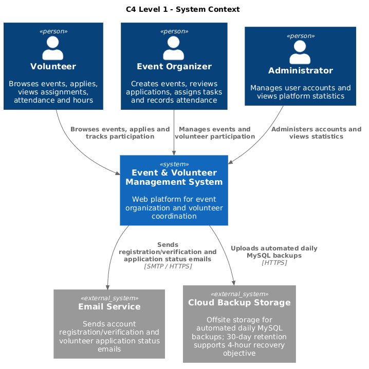
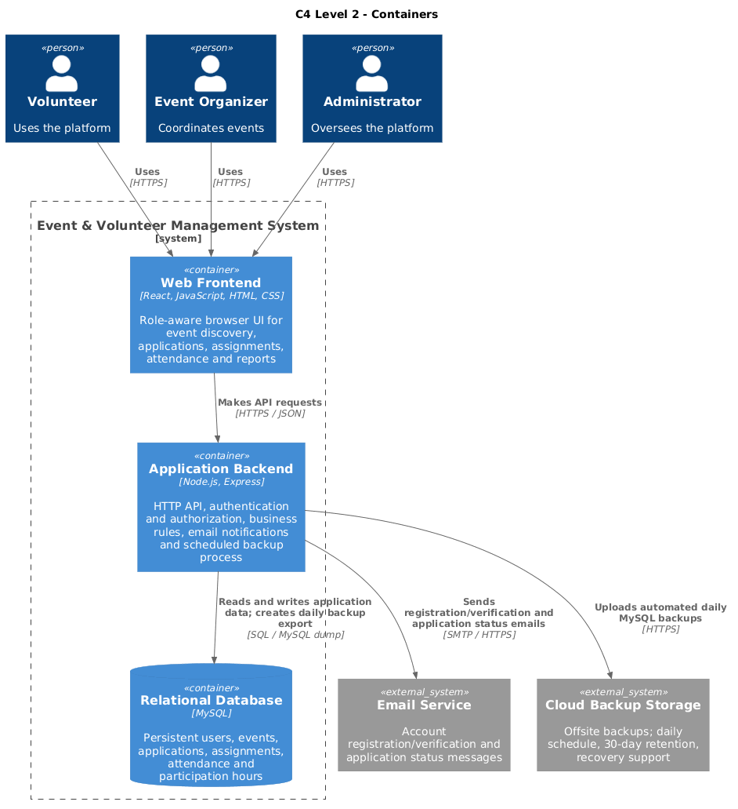
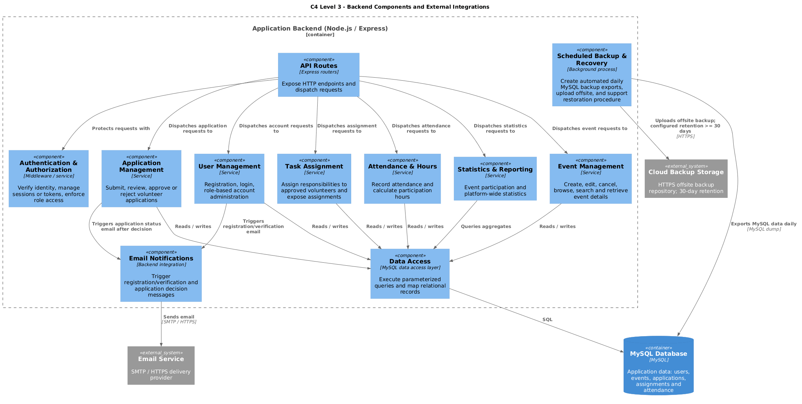

# System Architecture

## Overview and architectural style

The Event & Volunteer Management System is a web-based, three-tier client-server application. A browser-based React frontend presents the system to Administrators, Event Organizers, and Volunteers. It communicates over HTTPS with a Node.js/Express backend, which applies authentication, role authorization, validation, and business rules. The backend accesses the MySQL database and integrates with two external systems: an Email Service and Cloud Backup Storage. The browser does not connect directly to MySQL or either external system.

### Three tiers

1. **Presentation tier — React client:** Renders role-aware screens, gathers user input, and displays event listings/details, application status, assignments, attendance records, volunteer hours, and reports. It sends and receives JSON API requests over HTTPS.
2. **Application tier — Node.js and Express server:** Exposes HTTP API routes, authenticates requests, enforces Administrator / Event Organizer / Volunteer permissions, validates input, and runs business logic. It coordinates user, event, application, assignment, attendance, reporting, email notification, and scheduled backup operations.
3. **Data tier — MySQL database:** Stores persistent account and role data, events, volunteer applications and decisions, task assignments, attendance, and records used to calculate participation hours and statistics. The backend accesses it using SQL through a data-access boundary.

The application backend is also the integration boundary for the external systems. It sends registration/verification and application status messages to the Email Service over SMTP/HTTPS. A scheduled backend process exports MySQL application data and uploads daily backups over HTTPS to offsite Cloud Backup Storage. Configure that storage for at least 30 days of retention; the backup and restoration procedure supports the NFR-07 four-hour recovery objective. NFR-03 explicitly excludes time waiting for external services. These are logical responsibilities; provider, credentials, and deployment topology remain unspecified.

## C4 Level 1 — System Context

The system boundary contains the Event & Volunteer Management System. Its human actors remain:

- **Volunteer:** discovers events, applies, and checks application decisions, assignments, attendance, and hours.
- **Event Organizer:** manages events, reviews applications, assigns tasks, records attendance, and reviews event statistics.
- **Administrator:** manages user accounts and reviews platform statistics.

Two external systems support the functional and operational requirements:

- **Email Service:** receives email requests from the application for account registration/verification (FR-01) and volunteer application approval/rejection status (FR-12). The integration uses SMTP/HTTPS; NFR-03's completion time excludes waiting on this external service.
- **Cloud Backup Storage:** receives automated daily MySQL backups over HTTPS for offsite retention. Its intended configuration retains backups for at least 30 days (NFR-06) and supports the four-hour restoration objective after a declared incident (NFR-07).

## C4 Level 2 — Container

The three-tier containers remain the React **Web Frontend**, Node.js/Express **Application Backend**, and **MySQL Relational Database**. People use the frontend over HTTPS; it sends JSON API requests to the backend over HTTPS. The backend reads and writes the database using SQL and initiates daily MySQL backup exports. It sends registration/verification and application status emails to the external **Email Service** via SMTP/HTTPS. It uploads automated daily backup exports to external **Cloud Backup Storage** via HTTPS. The external storage is configured for a minimum 30-day retention period and is part of the recovery design for the NFR-07 four-hour objective. No browser-to-database or browser-to-external-service connection is shown.

## C4 Level 3 — Component

The Level 3 view expands the Express backend into responsibility-focused components:

- **API Routes** expose endpoints and dispatch incoming requests; **Authentication & Authorization** verifies identity and enforces roles.
- **User Management**, **Event Management**, **Application Management**, **Task Assignment**, **Attendance & Hours**, and **Statistics & Reporting** implement the corresponding use cases and access the database through **Data Access**.
- **Email Notifications** receives triggers from user registration/verification and application approval/rejection workflows, then sends messages to the external Email Service using SMTP/HTTPS. External-service waiting is excluded from NFR-03 timing.
- **Scheduled Backup & Recovery** runs the daily MySQL export, uploads it to external Cloud Backup Storage using HTTPS, and supports the documented restore procedure. Configure offsite retention for at least 30 days; backup and recovery operations support NFR-06 and NFR-07.

Component boundaries and the scheduled process are logical design responsibilities, not claims that application code or external provider configuration already exists. Endpoint contracts, provider, schema, deployment, retention configuration, and restore runbook remain implementation/deployment decisions.

## Requirement alignment

Email integration supports FR-01 and FR-12; NFR-03 excludes external-service wait time. Daily offsite backups with 30-day retention address NFR-06, while the restore procedure and stored backups support the NFR-07 four-hour recovery objective. A requirement mapping is recorded in `docs/traceability_matrix.md`.

## Diagram sources

Editable PlantUML sources: `uml/system_context.puml`, `uml/container.puml`, and `uml/component.puml`. Rendered PNGs: `uml/rendered/system_contex.png`, `uml/rendered/container.png`, and `uml/rendered/component.png`.