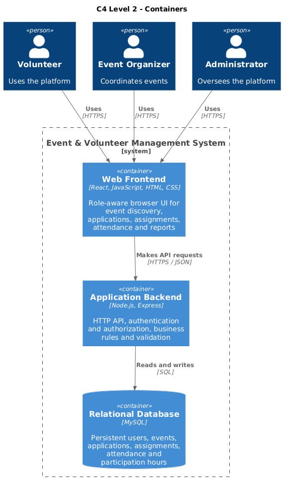
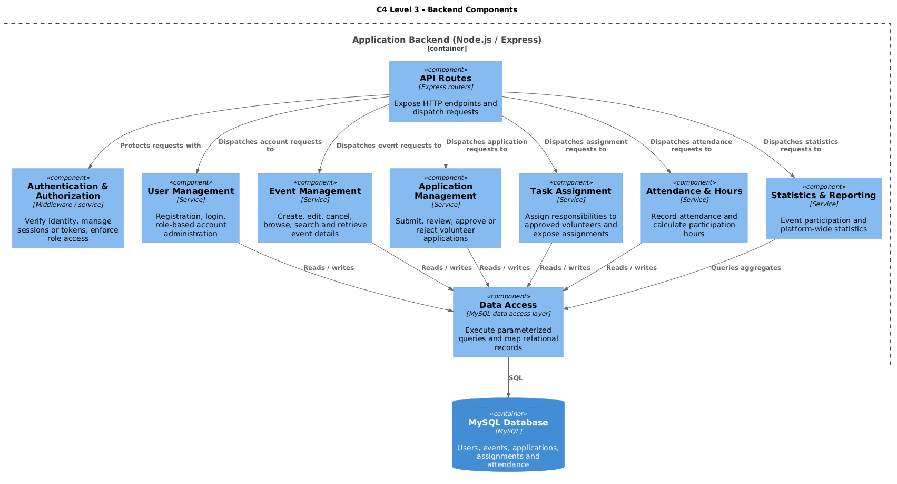

# System Architecture

## Overview and architectural style

The Event & Volunteer Management System is a web-based, three-tier client-server application. A browser-based React frontend presents the system to Administrators, Event Organizers, and Volunteers. It communicates over HTTPS with a Node.js/Express backend, which applies authentication, role authorization, validation, and business rules. The backend is the only application tier that accesses the MySQL database; the browser does not connect to MySQL directly.

### Three tiers

1. **Presentation tier — React client:** Renders role-aware screens, gathers user input, and displays event listings/details, application status, assignments, attendance records, volunteer hours, and administrative or organizer statistics. It sends and receives JSON API requests over HTTPS.
2. **Application tier — Node.js and Express server:** Exposes HTTP API routes, authenticates requests, enforces the Administrator / Event Organizer / Volunteer permissions, validates input, and runs the use-case logic. Its services coordinate user, event, application, assignment, attendance, and reporting operations.
3. **Data tier — MySQL database:** Stores persistent account and role data, events, volunteer applications and decisions, task assignments, attendance, and the records needed to calculate participation hours and statistics. The backend accesses it using SQL through a data-access boundary.

The client-server separation centralizes business rules and access control in the backend, while the relational data tier provides durable storage and relationships between users, events, and participation records. These are logical tiers; deployment topology and hosting choices have not yet been specified.

## C4 Level 1 — System Context

The system boundary contains the Event & Volunteer Management System as one product. Its three external human actors are:

- **Volunteer:** discovers and searches available events, reviews details, submits applications, and checks application decisions, assigned tasks, attendance, and total volunteer hours.
- **Event Organizer:** creates, edits, or cancels events; reviews and decides applications; assigns tasks to approved volunteers; records attendance; and reviews event participation statistics.
- **Administrator:** manages user accounts and reviews overall platform statistics.

All three actors interact with the system through its web interface. The context view intentionally treats the application as a single system and does not show its internal technology or data stores.

## C4 Level 2 — Container

The system is decomposed into three runtime containers. The **Web Frontend** is a React application running in the user's browser. It presents role-appropriate workflows and exchanges JSON requests with the **Application Backend** using HTTPS. The backend is a Node.js process using Express; it owns API routing, authentication and authorization, validation, and domain operations. It reads and writes the **MySQL Relational Database** using SQL. The database stores user, event, application, assignment, and attendance information. Users reach the frontend over HTTPS; there is no direct browser-to-database connection.

## C4 Level 3 — Component

The Level 3 view expands the Express application backend into responsibility-focused components:

- **API Routes** expose endpoints and dispatch incoming requests.
- **Authentication & Authorization** verifies identity and enforces role access before protected operations.
- **User Management** handles account registration, login, and administrator account management.
- **Event Management** supports event creation, editing, cancellation, discovery, search, and details.
- **Application Management** accepts volunteer applications and lets organizers review, approve, or reject them.
- **Task Assignment** assigns responsibilities to approved volunteers and returns their assignments.
- **Attendance & Hours** records attendance and derives participation hours from those records.
- **Statistics & Reporting** produces event participation and platform-wide statistics.
- **Data Access** centralizes MySQL queries and record mapping; domain services use it rather than connecting directly to the database.

This is a logical component design derived from the project requirements, not a claim that these modules or implementation details already exist in application code. Endpoint contracts, authentication mechanism, schema, and deployment decisions remain to be defined during implementation.

## Diagram source files

Editable PlantUML source is in `uml/system_context.puml`, `uml/container.puml`, and `uml/component.puml`. Rendered diagrams are in `uml/rendered/`.